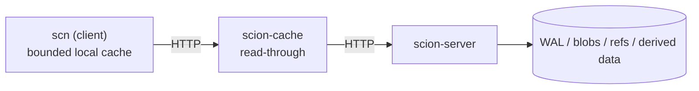
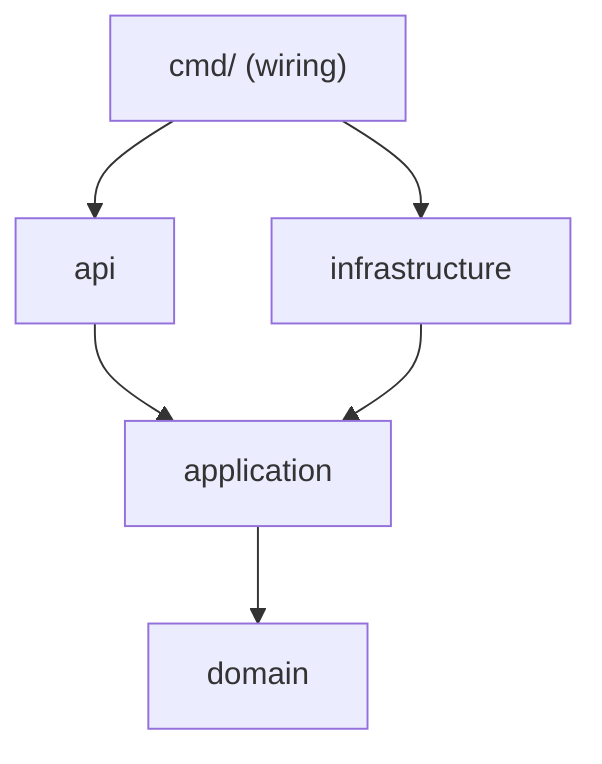

# mini-scion

一個從零開始、一步一步實作的超迷你版 **Scion**:Anthropic 內部重新設計的版本控制系統([原文](https://www.anthropic.com/engineering/redesigning-source-control))。這是學習專案,目標是理解 Scion 的核心設計,而不是做出可用的 Git 替代品。

這份 README 同時是**專案的長期計畫**。每完成一個 Phase 就更新「進度」與「計畫修訂紀錄」。

## 目錄
- [mini-scion](#mini-scion)
  - [目錄](#目錄)
  - [1. 目前進度](#1-目前進度)
  - [2. 快速開始](#2-快速開始)
  - [3. 開發環境與限制](#3-開發環境與限制)
  - [4. Scion 設計對照與非目標](#4-scion-設計對照與非目標)
  - [5. 架構](#5-架構)
  - [6. 技術選型與 Trade-off](#6-技術選型與-trade-off)
  - [7. 開發規範與工作方式](#7-開發規範與工作方式)
    - [規範:保留與調整](#規範保留與調整)
    - [工作方式:我寫、你驗證](#工作方式我寫你驗證)
    - [Git 與 Commit](#git-與-commit)
  - [8. 學習路線圖](#8-學習路線圖)
  - [9. 測試與品質](#9-測試與品質)
  - [10. 文件索引](#10-文件索引)
  - [11. 計畫修訂紀錄](#11-計畫修訂紀錄)
  - [參考](#參考)

---

## 1. 目前進度

**目前在 Phase 0(環境與骨架),分支 `phase/0-setup`。** `CLAUDE.md` 與 CI 已撰寫,等 CI 在 GitHub 上第一次全綠後,開 PR 合併並打 tag `phase-0-setup`。

| Phase | 主題 | 狀態 |
|---|---|---|
| 0 | 環境與骨架 | 進行中:0.0 到 0.5 的檔案都已完成,待 CI 第一次執行結果 |
| 1 | 內容定址 blob store | 待做 |
| 2 | Changeset 與 WAL | 待做 |
| 3 | Ref、CAS、server 端 commit | 待做 |
| 4 | Derived data 框架 | 待做 |
| 5 | 查詢服務(diff、merge-base、blame) | 待做 |
| 6 | HTTP API(`scion-server`) | 待做 |
| 7 | `scn` 客戶端 | 待做 |
| 8 | `scion-cache` 分層快取 | 待做 |
| 9 | 強化與驗收(`v0.1.0`) | 待做 |

細項待辦見 [`todo.md`](todo.md)。

## 2. 快速開始

**需求:** macOS 11 或更新、Go 1.24.x、git、Xcode(`go test -race` 需要 C 工具鏈)。Docker 為可選。

```bash
git clone https://github.com/mangreen/mini-scion.git
cd mini-scion
go env -w GOTOOLCHAIN=local   # 只需設定一次,避免自動下載跑不動的新工具鏈
make check                    # lint + 測試 + 腳本測試 + 機密掃描
```

| 指令 | 作用 |
|---|---|
| `make fmt` | 以 `gofmt` 格式化 |
| `make lint` | 檢查格式(有檔案需要格式化就失敗)並執行 `go vet` |
| `make test` | `go test -race -count=1 ./...`(永遠帶 `-race`) |
| `make test-scripts` | 測試 `tools/scripts/` 裡的 shell 工具 |
| `make scan` | 對整個專案做機密掃描 |
| `make check` | 以上全部,提交前必跑 |

環境變數見 [`.env.example`](.env.example)。複製成 `.env` 後填入自己的值,`.env` 已被 `.gitignore`,**不得提交**。

## 3. 開發環境與限制

開發機:MacBook Pro (Retina, 13-inch, Mid 2014),雙核 i7、16 GB、macOS Big Sur 11.7.11。完整記錄見 [MEM-0001](.agents/memories/MEM-0001-environment-and-toolchain.md)。

| 限制 | 影響 | 對策 |
|---|---|---|
| Go 1.24 是最後支援 macOS 11 的版本(1.25 起需要 macOS 12) | 不能使用較新的 Go | 固定 Go 1.24.x(目前 1.24.13),`go.mod` 寫 `go 1.24.13` |
| Go 1.24 已不再收到安全修補 | 不適合對外服務 | server 只綁 `127.0.0.1` |
| 新套件常要求較新的 Go | `go get` 可能拉高 `go.mod` 版本 | 只用標準庫,零第三方依賴 |
| `GOTOOLCHAIN` 預設會自動下載新工具鏈 | 下載的版本在 Big Sur 跑不動 | `go env -w GOTOOLCHAIN=local` |
| Homebrew 對 Intel Mac 已降為 Tier 3 | 新套件可能得從原始碼編譯 | 不依賴 Homebrew;用官方 `.pkg` 安裝 Go |
| Docker Desktop 4.12.0 版本很舊,雙核機器負擔大 | 拖慢測試、相容性不確定 | 可選工具,不放進主線;不使用時退出 |
| macOS 內建 bash 3.2、BSD 版 grep/find | shell 腳本行為與 Linux 不同 | 腳本一律以 bash 3.2 與 POSIX 工具為準(見 [MEM-0003](.agents/memories/MEM-0003-secret-scanning.md)) |

已實測:`make check` 在這台機器上通過,包含 `-race` 能偵測到 data race,以及 shell 腳本在 bash 3.2 與 BSD grep 下的行為。

## 4. Scion 設計對照與非目標

| Scion 的設計 | mini-scion 的作法 | Phase |
|---|---|---|
| Changeset 存在 write-ahead log,記錄相對第一個 parent 的檔案變更與內容定址指標 | 本機 append-only JSONL 檔;blob 存成 `objects/ab/cdef…`(sha256 + gzip) | 1, 2 |
| 所有 commit 在 server 端產生,沒有 push | `POST /v1/changesets`,由 server 建立 changeset | 3, 6 |
| 只有 main 這類少數 ref,更新是 compare-and-swap | `PUT /v1/refs/main` 帶 expected id,衝突回 409 | 3 |
| Derived data 由 parent 的值遞迴算出,可選 eager 或 lazy | 通用 `Derived[T]` 框架;實作 generation、tree、path history、blame | 4, 5 |
| Server 提供完整查詢 API,不需要本機 repo | diff、merge-base、log、blame 全走 API | 5, 6 |
| 客戶端只要求想要的 tree 與 blob,物件不可變 | `scn` 遞迴抓缺少的物件,可中斷續傳,不做 have/want 協商 | 7 |
| 客戶端有容量上限的本地快取,支援 sparse checkout | LRU 快取加 `scn clone --sparse dir/` | 7 |
| daemon、cache、server 講同一套 RPC | `scion-cache` 與 `scion-server` 同一套 HTTP API,可分層串接 | 8 |

**刻意不做:** Spanner 與水平擴展、virtualized checkout(需要 FUSE)、IAM 與目錄權限、Antique 與 CI、Claude superfan。目錄權限與 server 端 rebase 列為加分題。

## 5. 架構

最終形態:每一層都講同一套 API,客戶端不需要知道中間有幾層。



程式內部採 Hexagonal Architecture,依賴只能由外往內:



| 層 | 內容 | 規則 |
|---|---|---|
| `internal/domain` | Changeset、Path、BlobID、Ref | 純邏輯,無 I/O,不 import 其他層 |
| `internal/application` | Use case 與 ports(BlobStore、ChangesetLog、RefStore、DerivedStore) | 只 import domain |
| `internal/infrastructure` | 檔案 blob store、WAL、ref store、LRU 快取、HTTP client | 實作 ports;不 import api |
| `internal/api` | HTTP handlers、DTO 驗證、middleware | 不直接 import infrastructure,組裝在 `cmd/` |

這條依賴規則會在 Phase 1 加上自動化測試強制檢查,而不只是文件。

**專案結構**

```text
mini-scion/
├── CLAUDE.md  README.md  CHANGELOG.md  todo.md  Makefile  go.mod  .env.example
├── .agents/{memories,errors,skills}/   # MEM-*.md 決策、ERR-*.md 重大錯誤、SKILL-*.md 可重用流程
├── .github/workflows/ci.yml
├── docs/{architecture,api,diagrams,reports}/
├── tools/scripts/                      # scan-secrets.sh 與其測試,之後加入 check-coverage.sh、e2e.sh
├── cmd/{scion-server,scion-cache,scn}/
└── internal/{domain,application,infrastructure,api}/
```

## 6. 技術選型與 Trade-off

**語言:Go 1.24,零第三方依賴**

| | 內容 |
|---|---|
| Pros | 標準庫已含 HTTP、sha256、gzip、JSON、slog、測試、fuzzing、race detector;編譯快,雙核也不卡;單一執行檔,貼近 Scion 的 `scn` 與 daemon 形態 |
| Cons | 1.24 已停止維護;無法使用新套件 |
| Reason | 在 Big Sur 上唯一零摩擦的選擇。Rust 在雙核上編譯慢、學習曲線陡;Node 與 Python 的依賴鏈要逐一驗證 |

**儲存與傳輸:檔案加 WAL,HTTP/JSON**

| | 內容 |
|---|---|
| Pros | 直接對應 Scion 的概念;不需要 cgo、protoc;省掉 gRPC 與 SQLite 的依賴 |
| Cons | 沒有現成索引,查詢效率要靠 derived data 自己做,這正是學習重點 |
| Reason | 儲存都藏在 port 後面,日後想換成 SQLite 只需換一個 adapter |

## 7. 開發規範與工作方式

### 規範:保留與調整

**保留不變:** TDD、AAA 與測試命名、80% 覆蓋率門檻(domain 與 application)、並發測試、Idempotency-Key、結構化 log 與 trace-id、機密管理、Conventional Commits、註解規範(只寫「為什麼」)、修改前先做 Impact Graph。

**調整:**

| 項目 | 調整 | 原因 |
|---|---|---|
| 輸入驗證 | `json.Decoder.DisallowUnknownFields()` 加領域驗證函式 | 效果等同 whitelist,不需要 class-validator |
| Testcontainers | 記憶體 fake、`t.TempDir()`、`httptest` | 舊版 Docker 與雙核機器不適合,且不引入依賴 |
| 依賴掃描 | `govulncheck` 只在 GitHub Actions 跑 | 新版工具可能要求較新的 Go |
| 機密掃描 | 本機 `scan-secrets.sh`;CI 另跑 gitleaks | 本機不裝 gitleaks;兩層互補 |
| E2E | 本機 `make e2e`,在 localhost 起 server、cache、`scn` | 沒有 staging 環境 |
| 目錄 | Go 慣例 `cmd/` 加 `internal/`,仍是四層 | 對應規範的 `src/` |
| MEM 與 ADR | 只留 `.agents/memories/MEM-*.md`,當作 ADR | 避免重複記帳 |
| 報告 | 每個 Phase 一份 retrospective,取消每日、每週、每月報告 | 自學專案過重 |
| Git | Phase Flow | 規範已提供 |

### 工作方式:我寫、你驗證

專案由 Claude 負責撰寫完整程式、測試與設計文件;你負責**執行、驗證、讀懂,並指出不合理之處**。每個步驟的節奏:

1. **概念:** 對應 Scion 文章的哪一段,以及為什麼這樣設計。
2. **設計:** 畫 Impact Graph;有取捨時寫 trade-off;重要決策記成 MEM。
3. **Red → Green → Refactor:** 先有失敗的測試,再有實作,再重構。每一步都小。
4. **驗證:** 你在本機執行 `make check`,貼回結果;重要程式做變異驗證(故意改壞,確認測試會失敗)。
5. **Commit:** 一個可測試的單元對應一個 Conventional Commit。
6. **Phase 收尾:** demo、retrospective、更新文件、打 tag,經確認才進下一個 Phase。

### Git 與 Commit

採用 **Phase Flow**:`main` 永遠穩定;每個 Phase 一個 `phase/N-name` 分支,透過 PR 合併,合併後**保留分支**,並打 tag `phase-N-*`;最後一個 tag 為 `v0.1.0`。

Commit 格式:`<type>(<scope>): <subject>`,type 為 `feat`、`fix`、`test`、`refactor`、`docs`、`chore`。內文說明 what 與 why。

## 8. 學習路線圖

假設你有基本程式經驗,但沒寫過 Go;Go 語法會穿插在各 Phase 裡。時數為粗估,總計約 57 小時,每週投入 6 到 8 小時約 7 到 10 週。

| Phase | 主題 | 學到什麼 | 驗收標準 | 時數 |
|---|---|---|---|---|
| 0 | 環境與骨架 | Go module、`go test`、CI、機密掃描、shell 可攜性 | `make check` 通過;CI 綠燈;`CLAUDE.md` 與 MEM 完成;打 tag `phase-0-setup` | 3 |
| 1 | 內容定址 blob store | 雜湊、不可變資料、interface 與 port、`io` | 相同內容得到相同 ID;讀取時驗證雜湊,竄改會被偵測;同內容並發寫入安全;依賴方向測試;`check-coverage.sh`(80% 門檻) | 4 |
| 2 | Changeset 與 WAL | 領域建模、canonical encoding、append-only log、crash recovery | Changeset ID 可重現;append 後可重放;最後一筆被截斷時能復原;Path 驗證拒絕 `..` 與絕對路徑 | 6 |
| 3 | Ref、CAS、server 端 commit | 並發、compare-and-swap、idempotency | 10 個並發更新只有 1 個成功、其餘回衝突;相同 Idempotency-Key 回相同結果;`-race` 乾淨 | 5 |
| 4 | Derived data 框架 | 遞迴定義、memoization、eager 與 lazy | 每個 changeset 的衍生值只算一次;依序套用變更得到的 tree 與框架算出的一致;eager 與 lazy 結果相同 | 6 |
| 5 | 查詢服務 | diff 演算法、merge-base、path history、blame | 在手工建立的歷史上結果正確;blame 與樸素的重算結果一致(property test) | 8 |
| 6 | HTTP API | hexagonal adapter、嚴格 DTO、全域錯誤處理、trace-id、slog、OpenAPI | OpenAPI 文件完成;未知欄位回 400;錯誤回應不含 stack trace;每行 log 都有 trace-id;Idempotency-Key 生效 | 6 |
| 7 | `scn` 客戶端 | want-based 抓取、有上限的 LRU、sparse checkout | sparse clone 只抓需要的 blob;快取不超過上限;中斷後可續傳;commit 只送出變更 | 9 |
| 8 | `scion-cache` 分層快取 | read-through、不可變物件快取、singleflight、故障隔離 | 第二次請求由快取回應(命中計數);並發的相同 miss 只向上游請求一次;快取掛掉時行為有定義且有測試 | 5 |
| 9 | 強化與驗收 | fuzzing、benchmark、fault injection | WAL decoder 與 Path 驗證 fuzz 數十秒無 crash;commit 成本隨「變更大小」而非「repo 大小」成長的 benchmark;README 定稿;打 `v0.1.0` | 5 |

**加分題:** server 端三方 rebase 與 merge、目錄層級權限、用腳本模擬 superfan 監控、用 Docker compose 起三層架構的 demo。

## 9. 測試與品質

- **測試金字塔:** Unit 約 70%(純 domain 與 use case,I/O 用 fake)、Integration 約 20%(adapter 搭配 `t.TempDir()`、`httptest`)、E2E 約 10%(只測關鍵 happy path,本機起三個 process)。
- **一律 `-race`:** 沒有它,並發 bug 可能 97% 的時間都亮綠燈(實驗數據見 [MEM-0002](.agents/memories/MEM-0002-testing-discipline.md))。
- **並發邏輯:** 結果斷言加 `-race`,必要時 `-count=N`;新測試做一次變異驗證。
- **CI(GitHub Actions):** `test`(Go 1.24 與最新版各跑 `make check`)、`shell-macos`(用 Apple 內建的 bash 3.2 與 BSD grep 測試腳本)、`secrets`(gitleaks 掃完整歷史)、`vulncheck`(govulncheck)。設計見 [MEM-0004](.agents/memories/MEM-0004-ci-pipeline.md)。
- **覆蓋率:** domain 與 application 層至少 80%,CI 低於門檻就失敗。門檻腳本在 Phase 1 隨第一批程式一起建立。
- **機密:** 不得硬編碼任何密碼、金鑰、token、私鑰或連線字串;一律走環境變數;`make scan` 加 CI 的 gitleaks 兩層把關。細節見 [MEM-0003](.agents/memories/MEM-0003-secret-scanning.md)。
- **API 原則(Phase 6 起):** DTO 白名單驗證、狀態變更端點支援 Idempotency-Key、JSON 結構化 log 含 trace-id、全域錯誤處理器回傳清理過的錯誤。

## 10. 文件索引

| 文件 | 內容 |
|---|---|
| [`MEM-0001`](.agents/memories/MEM-0001-environment-and-toolchain.md) | 開發環境、Go 版本、Docker 與 Homebrew 的取捨 |
| [`MEM-0002`](.agents/memories/MEM-0002-testing-discipline.md) | 測試紀律:`-race`、並發測試、變異驗證 |
| [`MEM-0003`](.agents/memories/MEM-0003-secret-scanning.md) | 機密掃描器設計、新手常犯的錯、專家會留意的地方 |
| [`todo.md`](todo.md) | 目前 Phase 的待辦清單 |
| [`CLAUDE.md`](CLAUDE.md) | 專案層級規範:協作模式、環境限制、工程原則、測試、安全、Git |
| [`MEM-0004`](.agents/memories/MEM-0004-ci-pipeline.md) | CI 設計、新手常犯的錯、尚未驗證的清單 |
| [`ci.yml`](.github/workflows/ci.yml) | GitHub Actions:race 測試、macOS shell 測試、gitleaks、govulncheck |
| `CHANGELOG.md` | 值得注意的變更紀錄(隨第一個功能一起建立) |

## 11. 計畫修訂紀錄

| 日期 | 修訂 | 原因 |
|---|---|---|
| 2026-10-15 | 初版計畫:Go 1.24.x、零依賴、不使用 Docker | 依據 macOS 11.7.11 的限制 |
| 2026-10-15 | Go 版本固定為 1.24.13,Docker 改為可選 | 實測:本機已有 Go,Docker 4.12.0 能拉取並執行映像 |
| 2026-10-15 | `check-coverage.sh` 從 Phase 0 移到 Phase 1 | Phase 0 沒有任何程式可以量測覆蓋率 |
| 2026-10-15 | 新增四個 `doc.go` | `go vet ./...` 在沒有任何 Go 套件時會失敗;同時把分層依賴規則寫成文件 |
| 2026-10-15 | 工作方式改為「我寫、你驗證」 | 逐行引導寫 shell 腳本的效率太低,價值在於理解設計 |
| 2026-10-15 | 新增 `make test-scripts` 與 shell 腳本可攜性規則 | 本機是 bash 3.2 與 BSD 工具,已實測通過 |
| 2026-10-16 | 重新切分 Phase 0 的 commit,新增 `.editorconfig`,移除多餘的 `.gitkeep` | 一個 commit 應對應一個邏輯單元;五個檔案缺少結尾換行 |
| 2026-10-16 | CI 使用 Node 24 版 action:`checkout@v6`、`setup-go@v6`、`gitleaks-action@v3` | Node 20 已於 2026-09-16 從 GitHub 託管 runner 移除 |
| 2026-10-16 | CI 新增 macOS job,以受限 `PATH` 用 Apple 的 bash 3.2 與 BSD grep 測試腳本 | 本機環境與 Linux runner 不同 |
| 2026-10-16 | govulncheck 只在最新版 Go 上執行 | Go 1.24 已 EOL,其標準庫的已知漏洞不會回補,會讓 CI 永遠紅燈 |

## 參考

- [Redesigning source control at Anthropic](https://www.anthropic.com/engineering/redesigning-source-control)
